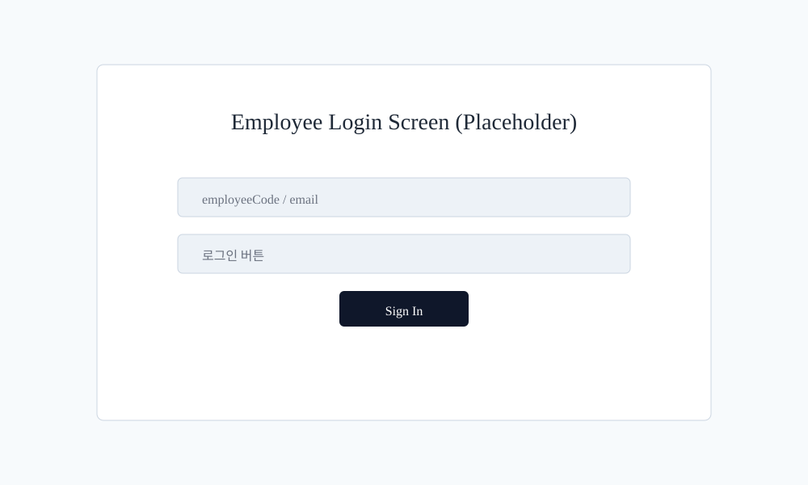
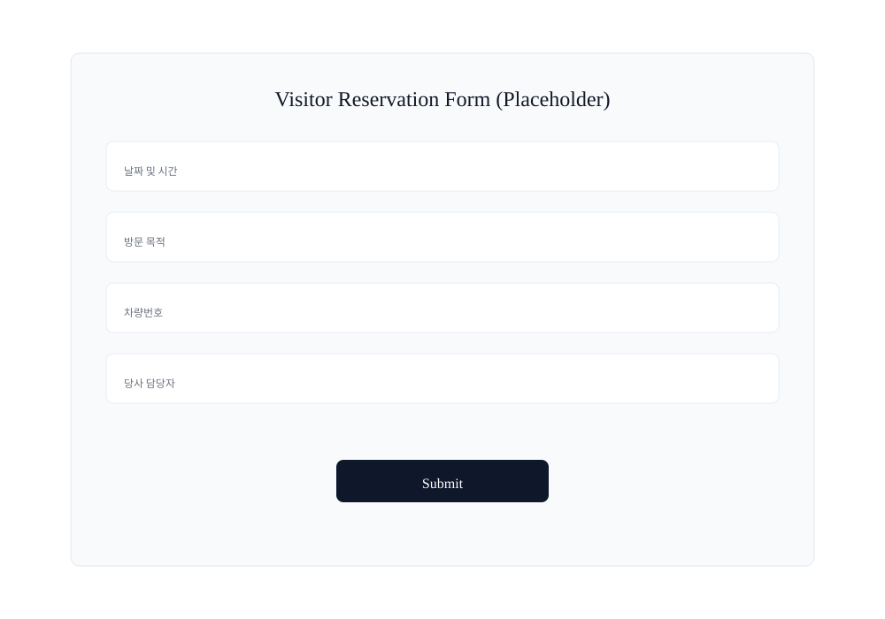
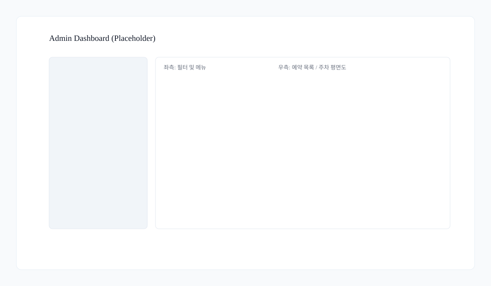

# 직원용 사용자 매뉴얼

## 개요
- 목적: 직원(사번 사용자)이 시스템을 통해 방문객을 대신 신청하거나 본인 방문을 관리하는 방법을 안내합니다.
- 대상: 회사 직원, 현장 담당자, 관리자(권한이 있는 경우 일부 기능)

---

## 빠른 시작
1. 브라우저에서 `/employee`로 접속합니다.
2. 사번으로 로그인합니다(그룹웨어 연동을 사용하는 환경에서는 그룹웨어에서 넘어오는 링크로 자동 로그인됩니다).
3. 로그인 후 `내 신청` 또는 `방문객 대리 신청` 메뉴로 이동해 예약을 생성합니다.
4. **최초 로그인 시 전화번호 등록이 필수입니다.** 전화번호가 등록되지 않으면 일부 기능(방문 대리 신청, 마이페이지 일부)이 제한됩니다.

---

## 스크린샷
아래 이미지는 배포 문서에 포함할 예시 화면 캡처 자리입니다. 실제 배포 전에는 로컬 서버에서 화면을 띄워 실제 스크린샷(또는 높은 해상도 캡처)으로 교체하세요.

*그림: 직원 로그인 화면 예시 (플레이스홀더)*

## 로그인
- 경로: `/employee/login` 또는 상단 `직원` 링크
- 인증: 사번으로 로그인합니다. 그룹웨어 연동 환경에서는 그룹웨어에서 전달된 링크로 자동 로그인될 수 있습니다.
- 주의: **최초 로그인 후 전화번호 등록이 필요합니다.** 전화번호 미등록 시 일부 화면 접근이 제한됩니다(당사 담당자 검증 용도).

---

## 방문객 대신 신청하기 (대리 신청)
1. `방문객 대신 신청` 진입
2. 방문객의 정보 입력: 성명, 회사명, 차량번호, 방문 일시 등
3. 개인정보 수집·이용 및 보안서약서 동의 여부를 체크(직원이 직접 확인했음을 대신 체크)
4. 제출 → 예약 접수 이메일 발송(방문객과 담당자 모두)

주의사항:
- 대리 신청 시 `당사 담당자`는 항상 로그인한 본인으로 고정됩니다.
- 방문객이 회원가입한 경우와 달리, 대리 신청은 방문객의 계정 생성과 무관합니다.

---

### 참고 화면
아래는 대리 신청과 관리자 대시보드 관련 예시입니다. 배포 전 실제 화면으로 교체하세요.

*그림: 방문객 대리 신청 폼(플레이스홀더)*

*그림: 관리자 대시보드(플레이스홀더)*

## 본인 방문 신청
- 직원 본인이 직접 방문하려면 `내 방문 신청`을 사용합니다.
- 화면에 보이는 용어: `내 방문 신청`으로 진입해 날짜/시간/차량번호 등을 입력하고 제출합니다.

---

## 예약 승인 및 취소 규칙
- 예약 생성 시 화면에 보이는 상태: `승인 대기`
- 신청 즉시 발송되는 이메일: **접수 확인 메일(즉시)** — 예약번호와 안전 조회 링크 포함
- 관리자가 `승인` 처리하면: **승인 메일(즉시)** 발송 — 배정된 주차면 코드 포함
- 관리자가 `반려` 처리하면: **반려 메일(즉시)** 발송 — 반려 사유 포함
- 예약 변경/취소 처리 시: **변경/취소 안내 메일(즉시)** 발송
- 입차 예정 리마인더: **입차 예정 N분 전** 발송(기본 10분, 시스템 설정에서 조정 가능). 입차 리마인더는 방문자와 담당자(호스트)에게 발송됩니다.
- 수정/취소 가능 기간(사용자 관점): **승인 전까지**, 그리고 **방문 시작 60분 전까지**. 승인 후에는 사용자가 직접 수정/취소할 수 없고, 변경이 필요하면 관리자에게 요청해야 합니다.
- 승인된 예약에 대한 관리자의 취소는 관리자 화면에서 사유를 입력해 처리하며, 취소 시 관련 메일이 발송됩니다.

---

## 예약 조회 및 관리
- `내 신청 내역`에서 본인 신청과 대리 신청을 구분해 확인합니다.
- 예약 상세에서는 화면에 보이는 상태(예: `승인 대기`, `승인됨`, `반려`, `취소됨`, `입차 처리`)와 배정된 주차면을 확인합니다.
- 이메일 발송 내역(관리자 전용)에서 전송 실패 사유를 확인할 수 있습니다.
- 반복 예약(정기 주차 배정)은 관리자 권한으로만 설정/수정/삭제 가능합니다.

---

## 알림 및 이메일
- 자동 발송되는 이메일 요약 (시점 기준):
	- 접수 확인 메일: 예약 제출 즉시
	- 승인 메일: 관리자가 승인 처리 즉시 (주차면 코드 포함)
	- 반려 메일: 관리자가 반려 처리 즉시 (반려 사유 포함)
	- 변경/취소 알림: 변경 또는 취소 처리 즉시
	- 입차 리마인더: 입차 예정 시각의 기본 `10분 전` (설정 변경 가능)
- 입차 리마인더는 방문자와 담당자(호스트)에게 발송됩니다.
- 이메일 발송 실패 및 전송 이력은 관리자 화면에서 확인할 수 있습니다.

---

## 자주 발생하는 상황 및 해결
- 사번으로 로그인 불가: 인사 명부에 사번이 없거나 계정 비활성화 상태. 관리자에게 문의.
- 전화번호 미등록: 마이페이지에서 전화번호 등록 후 이용 가능.
- 대리 신청 후 방문객이 메일을 못 받음: 입력한 이메일 주소 오타 가능 — 예약 상세에서 이메일 확인.

---

## 권한 관련 주의
- 직원은 본인의 신청 내역만 조회/관리할 수 있으며, 타인의 예약 수정·승인은 불가능합니다.
- 관리자 권한이 있는 직원은 관리자 기능을 사용할 수 있습니다(권한은 별도 관리).

---

## 추가 정보
- 더 자세한 운영 정책(승인 우선순위, 자동 배정 규칙 등)은 관리자 매뉴얼을 참고하세요.
- API 엔드포인트 관련 정보는 프로젝트의 API 문서 및 코드(`src/` 폴더)를 참조하세요.

---

## 스크린샷 교체 가이드
배포 전 플레이스홀더 이미지를 실제 스크린샷으로 교체하세요.

- 권장 해상도: 가로 1200px 이상 (Retina 대응 시 2x 사이즈 권장)
- 파일 형식: PNG 또는 SVG 권장
- 파일 경로: `docs/images/` — 기존 플레이스홀더를 덮어쓰기하거나 `*_real.png`로 추가
- 파일명 예: `employee-login.png`, `visitor-reservation-form.png`, `admin-dashboard.png`

스크린샷 팁:
- macOS: `Cmd+Shift+4` 또는 `Cmd+Shift+5`
- Windows: `Win+Shift+S`
- 브라우저 줌 100%로, 개발자 도구 숨김 상태에서 캡처하세요.

