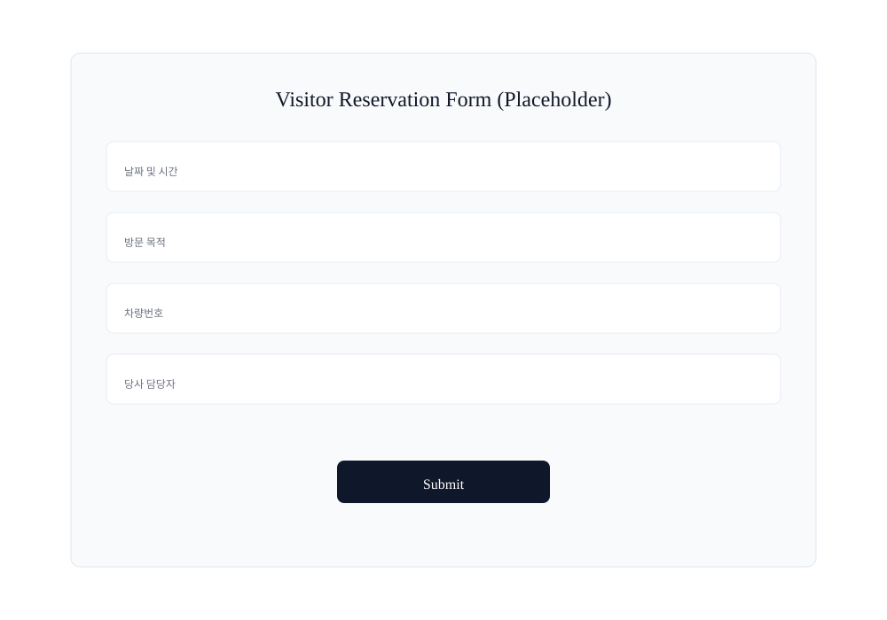
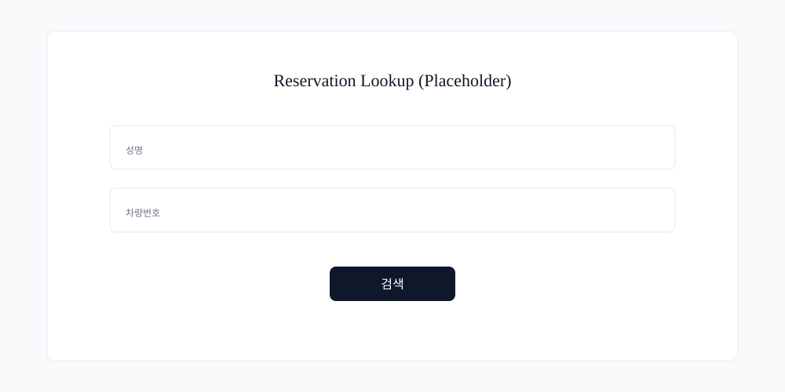
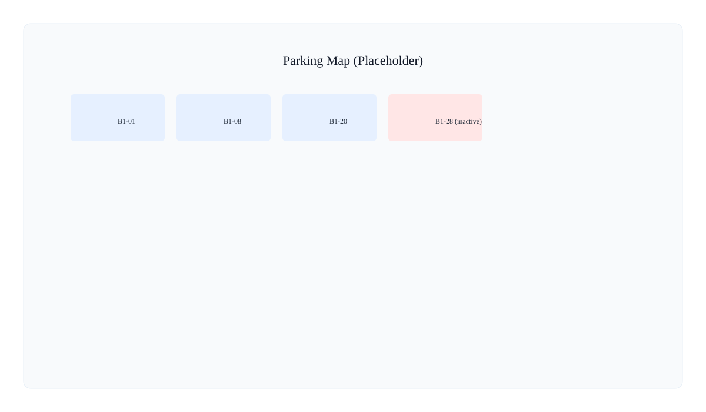

# 방문객용 사용자 매뉴얼

## 개요
- 목적: 방문객(사이트 사용자)이 회원가입 후 방문을 신청하고 예약을 조회·관리하는 방법을 안내합니다.
- 대상: 외부 방문객, 고객, 협력사 직원

---

## 빠른 시작
1. 웹사이트에 접속합니다: `http://localhost:3000`
2. 계정이 없으면 회원가입을 진행합니다(이메일, 비밀번호, 성명, 회사명, 차량번호 필수).
3. 로그인 후 `방문 신청` 메뉴에서 예약을 생성합니다.

---

## 스크린샷
배포 문서에 포함할 캡처 자리입니다. 실제 배포 전 로컬에서 앱을 열어 실 화면 캡처로 교체하세요.

*그림: 방문객 예약 폼(플레이스홀더)*

## 회원가입
- 입력값: 이메일, 비밀번호(8자 이상), 성명, 회사명, 차량번호, 당사 담당자(이름+전화번호)
- 당사 담당자 등록: 이름 + 전화번호로 직원 실존 여부를 검증(명부 목록은 노출하지 않음)
- 회원가입 완료 시 확인 이메일이 발송될 수 있음(설정에 따라 다름)

---

## 방문 신청(예약 생성)
1. `방문 신청`에서 날짜와 시간, 방문 목적, 차량 정보 등 필수 항목을 입력합니다.
2. 신청 제출 → 화면상 상태: `승인 대기` 로 생성하고 접수 확인 이메일을 즉시 수신합니다.
3. 예약 조회 방법:
   - 예약 조회 페이지에서 `성명` + `차량번호`를 입력해 검색합니다.
   - 또는 접수 이메일에 포함된 **안전 조회 링크**를 클릭해 바로 예약을 확인합니다.

---

### 예약 상태 및 이메일 안내
- 화면에 보이는 상태 용어: `승인 대기`, `승인됨`, `반려`, `취소됨`, `입차 처리` 등
- 이메일 발송 시점(요약):
   - 접수 확인 메일: 신청 제출 직후(즉시)
   - 승인 메일: 관리자가 승인 처리하면 즉시 발송(배정된 주차면 코드 포함)
   - 반려 메일: 관리자가 반려 처리하면 즉시 발송(반려 사유 포함)
   - 변경/취소 알림: 변경 또는 취소가 처리되면 즉시 발송
   - 입차 리마인더: 입차 예정 시각의 기본 `10분 전` 발송(설정에 따라 변경 가능)
- 예약 수정/취소 가능 시점(사용자 관점): **관리자 승인 전까지**, 그리고 **방문 시작 60분 전까지**. 승인 이후에는 직접 수정/취소할 수 없습니다.

---

## 예약 수정 및 취소
- 신청자가 직접 수정/취소 가능한 시점: 승인 전, 그리고 방문 시작 60분 전까지.
- 승인 또는 방문 시작 60분 이내에는 신청자가 직접 수정/취소 불가 — 담당 직원 또는 관리자에게 요청 필요.

---

## 승인 및 알림
- 관리자가 승인하면 승인 이메일을 수신하고 배정된 주차면 코드가 안내됩니다.
- 반려 시 반려 사유가 포함된 메일을 수신합니다.
- 출차 예정 알림(기본 10분 전)을 통해 출차 안내를 받습니다.

---

## 예약 조회(비회원 포함)
- 비회원도 이메일의 보안 토큰 링크를 통해 자신의 예약을 확인할 수 있습니다.
- 대안으로 `예약 조회` 화면에서 `성명` + `차량번호`를 입력해 일치하는 예약 목록을 확인할 수 있습니다.

---

### 참고 화면
예약 조회 예시와 주차 평면도 위치 확인 예시입니다. 배포 전 실제 캡처로 교체하세요.

*그림: 예약 조회(플레이스홀더)*

*그림: 주차 평면도 개요(플레이스홀더)*

## 마이페이지
- 내 예약 목록 확인
- 회원 정보 수정: 성명·회사명·차량번호·비밀번호 변경 가능
- 당사 담당자 변경은 이름+전화번호로 검증해야 적용

---

## 자주 묻는 질문
Q: 승인된 예약을 직접 변경할 수 있나요?
A: 아니요. 승인 이후에는 신청자가 직접 변경 불가이며 관리자에게 요청해 대신 처리해야 합니다.

Q: 메일을 못 받았어요.
A: 스팸함 확인, 입력한 이메일 주소 확인(오타 여부). 계속 문제 시 관리자에게 문의하세요.

---

## 문제 해결 요약
- 예약이 조회되지 않음: 성명·차량번호 정확히 입력했는지 확인. 보안 토큰 링크 사용 권장.
- 회원가입 문제: 비밀번호 조건(8자 이상) 확인. 이미 가입된 이메일인지 확인.

---

## 추가 안내
- 시스템은 자동으로 중복 예약 및 중복 주차 배정을 방지합니다.
- 운영 정책(예: 이중주차 사용 여부)은 관리자 설정에 따라 달라질 수 있습니다.

---

## 스크린샷 교체 가이드
플레이스홀더 이미지를 실제 스크린샷으로 교체하세요.

- 권장 해상도: 가로 1200px 이상
- 파일 형식: PNG 권장(또는 벡터 SVG)
- 파일 경로: `docs/images/` — 플레이스홀더를 덮어쓰기하거나 `*_real.png`로 추가
- 파일명 예: `visitor-reservation-form.png`, `reservation-lookup.png`, `parking-map-overview.png`

캡처 팁: 브라우저의 툴바/개발자도구를 숨기고 100% 줌에서 캡처하세요.

